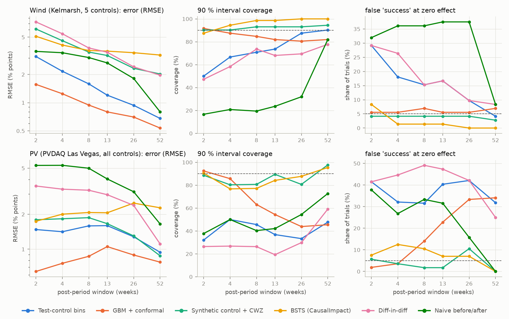
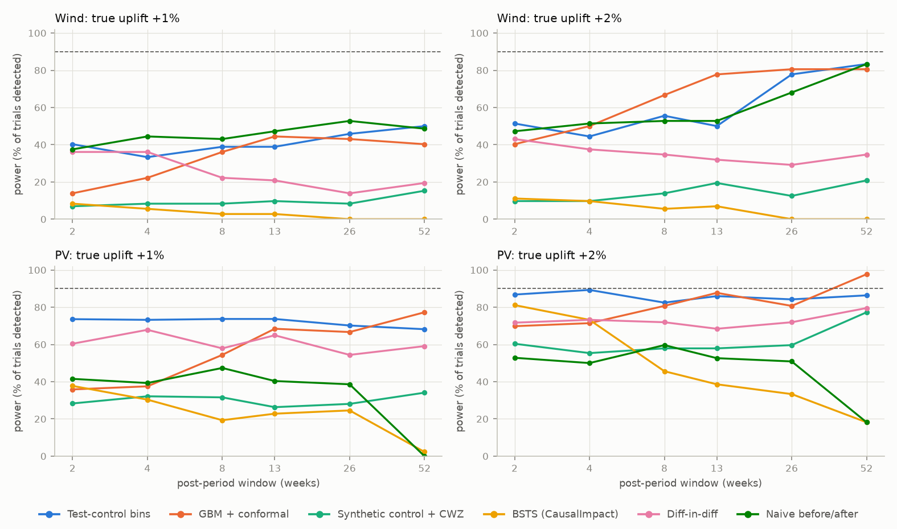
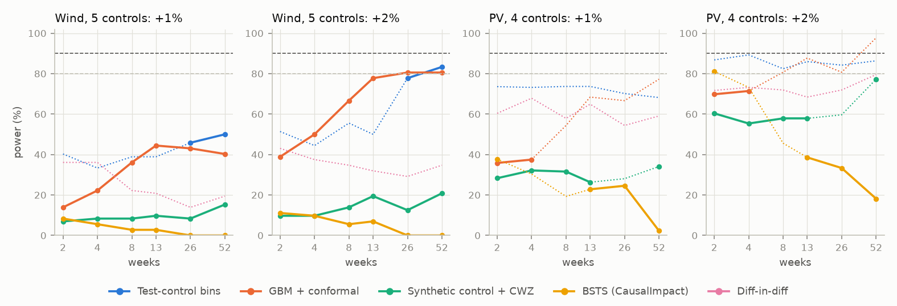
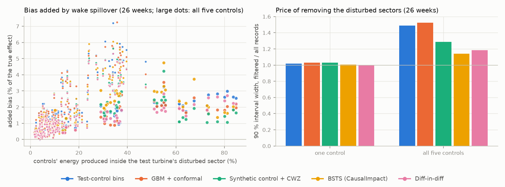
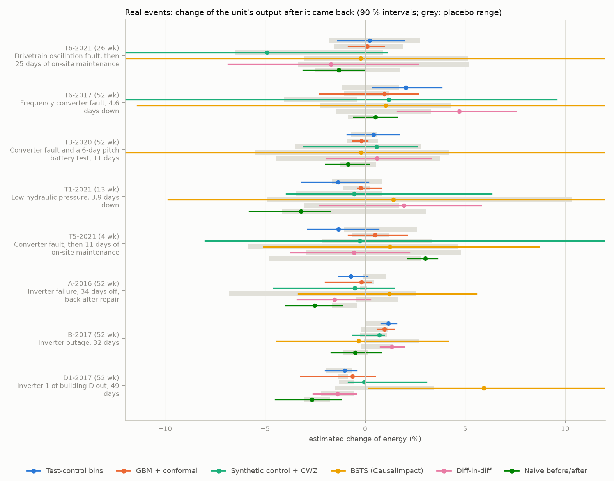
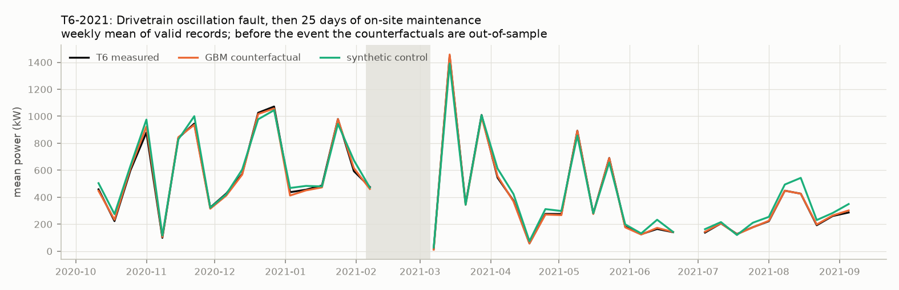

# Did the upgrade work? Causal verification of wind and PV interventions from SCADA data

[](https://github.com/kwwaleszczynski-del/res-uplift-verification/actions/workflows/ci.yml)

**Interactive dashboard with the test-plan calculator: <https://kwwaleszczynski-del.github.io/res-uplift-verification/>**

Vortex generators, pitch and yaw software, yaw calibration, blade repairs, component replacements, panel washing,
a new inverter - each promises something like +1 to +3 % more energy. The weather moves a turbine's or a PV
system's output by far more than that from one month or year to the next, so a before/after comparison says
almost nothing. Two practical questions follow:

1. **How do you measure such an effect credibly?** Against untouched control units of the same site, with a
   method whose uncertainty statement can be trusted.
2. **How much data do you need?** If a +1 % effect needs a year of data to be seen, a three-month test is a
   coin toss.

This project compares five causal-inference estimators (one of them the usual industry procedure) on real
SCADA data from an open wind farm and an open PV site, validates them by **injecting known effects into the real
data** (thousands of trials at random dates, units and control sets), turns the results into a **test-plan
calculator**, checks what happens when a control turbine stands **in the test turbine's wake**, and applies
everything to **real events from the logs**.

## Key results

* **Wind, five controls.** The gradient-boosting counterfactual with blocked cross-conformal intervals is the most
  precise method (RMSE 1.25 percentage points at 4 weeks, 0.54 at 52 weeks) and its false-success rate stays at
  6-7 %. The industry test-control method is unbiased, but its bootstrap intervals are too narrow for tests shorter
  than half a year (15-29 % false successes for 2- to 13-week windows, 4 % at 52 weeks). Synthetic control with
  conformal inference is the best calibrated (90 % intervals cover the truth in 90-94 % of trials, 3-4 % false
  successes) but about four times less precise: a linear mix of daily energies cannot follow direction-dependent
  wakes. CausalImpact-style BSTS is over-conservative: its random-walk level makes the interval grow with the window
  (half-width 15 % at 52 weeks).
* **How long a test?** With five controls and one year of pre-intervention data, a +3 % effect is detected with
  90 % power after about 9 weeks; +2 % reaches 80 % power after about 23 weeks but not 90 % within a year (81-83 %
  at 52 weeks); +1 % stays at or below 50 %. The floor is year-to-year drift of the test-control relation (about
  +-1 % at 90 % confidence), which more post-period data does not average away.
* **PV, four roofs.** Roofs of different tilt and orientation differ seasonally by +-5-10 % and by up to 4-5 %
  between the same month of different years (soiling or shading). Methods with tight intervals (gradient boosting,
  test-control bins, DiD) then claim false successes in a quarter to a half of the null trials from 13-week windows
  on; synthetic control (0-11 %, mostly below 5 %) and BSTS (0-12 %) stay honest, at the price of power
  (synthetic control finds +2 % in 58-77 % of trials).
* **Washing panels.** After a soiling ramp, only BSTS recovers what a wash gained (+2.1 % estimated for +2.1 % true
  in the first two weeks): its local level follows the soiled state just before the wash. Every method that learns
  one test-control relation from the whole pre-year estimates about +0.4 % and misses the benefit.
* **Wake spillover.** With a Gaussian wake model, the test turbine's upgrade biases the estimate upwards by 1.6-2.3 %
  of the effect with five controls (up to 6-7 % for a single control that stands in the wake a third of the time).
  Removing the IEC disturbed sectors removes the bias but widens the gradient-boosting and test-control intervals
  1.5 times - at Kelmarsh spacing the cure costs more than the bias.
* **Real events.** After a 25-day maintenance stop, two converter faults and a hydraulic fault, the turbines came
  back within +-1 % of their former performance (gradient boosting: +0.1 %, -0.2 %, -0.2 %, +0.5 %), where a
  before/after comparison of the same events reports -3.2 % to +3.0 %. A PV inverter that had been losing about 9 %
  before it failed shows +5.9 % with BSTS (gain against the degraded state just before the repair) and -1.4 to
  0 % with the other methods (against the typical pre-year): two different questions, both legitimate.



## Data

| Site | What | Units used | Period | Licence |
|---|---|---|---|---|
| Kelmarsh wind farm (UK) | 10-minute SCADA and status logs, Greenbyte export (Plumley 2022, Zenodo record 16807551) | 6 x Senvion MM92 (2.05 MW, 92 m rotor); nearest neighbours 270-390 m (2.9-4.3 rotor diameters) apart | 2016-2021 | CC BY 4.0 |
| Andre Agassi Preparatory Academy, Las Vegas (US) | NREL PVDAQ, 15-minute inverter and met data (Deline et al. 2021) | roofs A (system 34, 147 kWp), B (1276, 68 kWp), D (1278, two inverters D1/D2, 171 kWp), gymnasium G (35, 122 kWp, west-facing) - one site, one met station | 2016-2018 | CC BY 4.0 |

Records count only in normal operation: for wind, the cleaning of the author's
[wind-power-curve-kelmarsh](https://github.com/kwwaleszczynski-del/wind-power-curve-kelmarsh) project (status-log
stops and derating, frozen or disagreeing anemometers, pitched-out curtailment, icing; wind speed rebuilt as the
mean of both nacelle anemometers because the SCADA signal changes definition in April 2018, density-normalised);
for PV, irradiance of at least 100 W/m2, no inverter error code and the inverter producing. A day enters an
analysis when the test unit and every control were valid for at least six hours (wind) or three hours (PV).
Building C of the school (1277) only reports from November 2017 and is not used. The ambient temperature sensor
of the PV site drops out for weeks in winter (seen before in the author's
[pv-thermal-check](https://github.com/kwwaleszczynski-del/pv-thermal-check)); as temperature is only a covariate
here, its gaps are filled with a seasonal x diurnal harmonic fit. The PVDAQ power channels of these systems
switch from hectowatts to watts on 4 August 2018 (all values jump 100-fold in the middle of the day); the switch
is detected from power per irradiance and converted. A first PV run without this correction produced
"effects" of +2500 % for the gradient-boosting and naive methods while the ratio methods, which see all units
jump together, did not notice.

The raw data are not in the repository. `python -m res_uplift fetch-pv` downloads the PVDAQ files (~48 MB); the
Kelmarsh archives (~1.8 GB) come from Zenodo and are read from `$KELMARSH_DATA_DIR`.

## The estimand

For an intervention on a test unit, the effect over a post-period window is the relative change of the test
unit's energy over the valid records of that window:

```math
\delta = \frac{\sum_{t \in \text{post}} y_t}{\sum_{t \in \text{post}} y_t(0)} - 1
```

where $`y_t(0)`$ is the power the unit would have produced without the intervention - never observed, so every
method builds it from control units that were left alone. A method reports $`\hat\delta`$ and 90 % and 95 %
intervals. "The intervention worked" is claimed when the lower bound of the 90 % interval is above zero (a one-sided
test at the 5 % level); when nothing was done, that claim should be made in about 5 % of cases.

## Methods

| Method | Counterfactual | Uncertainty |
|---|---|---|
| **Test-control bins** (industry practice) | pre-period ratio of test to control energy per bin of the controls' wind speed (1 m/s) and direction (30 deg); PV: irradiance (100 W/m2) x sun azimuth (30 deg) | moving-block bootstrap over days, pre and post resampled separately |
| **Synthetic control + conformal inference** | non-negative weighted sum of the controls' daily energy | test inversion with null-imposed refits and moving-block permutations (Chernozhukov, Wuethrich & Zhu 2021) |
| **Bayesian structural time series** (the CausalImpact approach) | local level plus spike-and-slab regression on the controls and weather, daily, shifted log scale | posterior predictive (Gibbs sampler) |
| **GBM counterfactual + conformal** | gradient boosted trees on the controls' power and the weather, every 10 or 15 minutes | blocked cross-conformal scores of window totals |
| **Difference-in-differences** | pre-period log ratio of test to control energy | moving-block bootstrap |
| Naive before/after (reference only) | the test unit's own pre-period power curve (own anemometer) or yield per irradiance bin | moving-block bootstrap |

**Test-control bins.** The procedure used in side-by-side upgrade tests (e.g. for vortex generators, see Hwangbo
et al. 2017 and Ding 2019, ch. 7; binning after IEC 61400-12-1). With $`r_b`$ the pre-period ratio of test to
control energy in bin $`b`$,

```math
\hat\delta = \frac{\sum_b E^{\text{test}}_{\text{post}}(b)}{\sum_b r_b \, E^{\text{ctrl}}_{\text{post}}(b)} - 1 .
```

The reference wind speed and direction come from the controls, never from the test turbine, whose nacelle
anemometer sits behind the rotor and changes its reading with the intervention.

**Synthetic control with conformal inference.** Weights $`w_j \ge 0`$ make the controls' daily mean power track
the test unit's in the pre-period (Abadie, Diamond & Hainmueller 2010, here without the adding-up constraint so
that units of different size can be combined). For the interval, the hypothesis $`\delta = \delta_0`$ is imposed by
deflating the post-period outcomes, the weights are re-fitted on all days, and the post-block statistic of the
residuals is compared with the same statistic of every cyclic shift of the residual series; the confidence set is
$`\{\delta_0 : p(\delta_0) > \alpha\}`$. The test is exact for exchangeable residuals and approximately valid under
stationarity and weak dependence (Chernozhukov, Wuethrich & Zhu 2021). As statistic the relative energy error of the
post block is used,

```math
S = \frac{\left| \sum_{t \in \text{post}} n_t \hat u_t \right|}{\sum_{t \in \text{post}} n_t \hat y_t},
```

($`n_t`$ valid records of day $`t`$) instead of the default sum of absolute residuals, which windy weeks dominate.

**Bayesian structural time series.** The CausalImpact model (Brodersen et al. 2015) on daily energy:

```math
\begin{aligned}
y_t &= \mu_t + x_t^\top \beta + \varepsilon_t, & \varepsilon_t &\sim N(0, \sigma_\varepsilon^2 / w_t) \\
\mu_t &= \mu_{t-1} + \eta_t, & \eta_t &\sim N(0, g_t \sigma_\eta^2)
\end{aligned}
```

with $`y`$ and the controls in $`x`$ on a shifted log scale (energy relations between units are multiplicative),
weather covariates (wind speed and temperature, or irradiance and temperature) in $`x`$, a spike-and-slab prior on
$`\beta`$ (George & McCulloch 1997; Scott & Varian 2014), $`g_t`$ the gap to the previous valid day and $`w_t`$
proportional to the day's valid records times the controls' energy (the log of a small daily energy is noisy).
A Gibbs sampler draws the level path in one block from its tridiagonal-precision Gaussian conditional (banded
Cholesky, the same draw as the simulation smoother of Durbin & Koopman 2002), the inclusion indicators with
$`\beta`$ integrated out, $`\beta`$ and both variances. Priors follow the CausalImpact defaults (level standard
deviation 0.01 sd(y), expected model size 3) except the observation-noise prior: its default (expected R2 0.8
worth 50 observations) is tuned for noisy business series and inflated the noise about five-fold on SCADA data,
where controls explain more than 99 % of the daily variance.

**GBM counterfactual with conformal intervals.** Gradient boosted trees (scikit-learn
`HistGradientBoostingRegressor`) predict the test unit's power record by record from the controls' power, their
mean wind speed, direction, temperature and turbulence and the hour of day (PV: irradiance, ambient temperature,
sun position). Errors of a window total are strongly autocorrelated, so the calibration works on windows, in the
spirit of CV+ / jackknife+ (Barber et al. 2021) and its block-wise time-series variants (Xu & Xie 2021): the
pre-period is split into five contiguous folds, each predicted by a model trained on the other four (two-day
embargo), and the relative errors of these out-of-fold predictions over all windows of the post-window's length are
the conformity scores. With their conformal quantiles $`e_{lo}, e_{hi}`$,

```math
\left[ \frac{1+\hat\delta}{1+e_{hi}} - 1, \; \frac{1+\hat\delta}{1+e_{lo}} - 1 \right].
```

Calibration windows are capped at a quarter of the pre-period (at least four non-overlapping windows).
Longer post windows keep the
quarter-period interval instead of shrinking it further, because errors that persist longer than a season cannot be
learned from one pre-year. This cap was set after the first validation run, which capped at half the pre-period:
there, the 90 % intervals covered the truth in only 45-65 % of the 26- and 52-week wind trials (two overlapping
half-year windows say almost nothing about the spread). With the quarter-period cap the coverage is 81-92 % on wind.
All numbers below come from the second run.

**Difference-in-differences.** The two-by-two DiD of log energy (test and controls, before and after),
$`\hat\delta = \exp\{[\log E^{\text{test}}_{\text{post}} - \log E^{\text{test}}_{\text{pre}}] - [\log E^{\text{ctrl}}_{\text{post}} - \log E^{\text{ctrl}}_{\text{pre}}]\} - 1`$,
with a moving-block bootstrap over days against serial correlation (Bertrand, Duflo & Mullainathan 2004;
Kuensch 1989). It is the test-control method with a single bin.

**Assumptions** shared by all methods: (i) *no spillover* - the intervention must not change the controls; on a
wind farm a control in the test turbine's wake violates this, see below; (ii) *a stable relation* between test and
controls apart from the intervention; seasons, wakes that depend on direction, sensor drift and unlogged changes at
the site all violate it a little, and the validation on real data is there to show how much that matters.

## Validation design

* **Trials.** Every unit in turn is the test unit (12 trials per unit); the intervention date is drawn at random
  (wind: May 2017 - December 2020, PV: January 2017 - June 2018); control sets of 1, 2, 3 units and all other units
  are drawn at random from the units with data. Pre-period: the 365 days before the date. Windows of 2, 4, 8, 13,
  26 and 52 weeks after it (only full windows inside the data).
* **Injected effects** of 0, 0.5, 1, 2, 3 and 5 % in three shapes: *uniform* (output x (1 + effect)); *partial-load*
  for wind (full effect up to 75 % of rated power, fading to zero at 95 % - how vortex generators and blade repairs
  act; the energy gain is smaller than the nominal value); *soiling then wash* for PV (the test roof loses output
  linearly for 60 days before the wash, the wash removes the loss, soiling resumes; the counterfactual keeps
  soiling - this one also bends the pre-period).
* **Scores** against the realised true effect of each window: bias, RMSE, coverage of the 90 % and 95 % intervals,
  false-success rate at zero effect, power (share of successes) by window length.
* The data are real, so whatever happened at the site in a trial's years - weather regimes, unlogged repairs,
  sensor drift - is part of the noise every method has to live with.

## Results in detail

### Wind: Kelmarsh, five controls, uniform injected effects

Errors and coverage in percentage points / percent of trials; 72 trials (12 per turbine) per window, effects of
0-5 % pooled for bias, RMSE and coverage; "false success" = lower 90 % bound above zero when no effect was injected;
power = the same claim when +2 % was injected.

| Method | Bias, 13 wk | RMSE, 4 / 13 / 52 wk | 90 % coverage, 4 / 13 / 52 wk | 95 % coverage, 13 wk | False success, 4 / 13 / 52 wk | Power for +2 %, 13 / 26 / 52 wk |
|---|---|---|---|---|---|---|
| GBM + conformal | -0.06 | 1.25 / 0.80 / 0.54 | 88 / 82 / 82 | 85 | 6 / 6 / 7 | 78 / 81 / 81 |
| Test-control bins | -0.00 | 2.16 / 1.20 / 0.68 | 67 / 74 / 90 | 81 | 18 / 17 / 4 | 50 / 78 / 83 |
| Synthetic control + CWZ | -0.30 | 4.59 / 3.19 / 2.02 | 90 / 93 / 94 | 100 | 4 / 4 / 3 | 19 / 12 / 21 |
| BSTS (CausalImpact) | +0.19 | 4.12 / 3.55 / 3.22 | 94 / 99 / 100 | 100 | 1 / 1 / 0 | 7 / 0 / 0 |
| Diff-in-diff | -0.01 | 5.44 / 3.45 / 1.97 | 58 / 68 / 78 | 74 | 26 / 17 / 8 | 32 / 29 / 35 |
| Naive before/after | -0.45 | 3.41 / 2.66 / 0.80 | 21 / 24 / 82 | 29 | 36 / 38 / 8 | 53 / 68 / 83 |

### PV: PVDAQ Las Vegas, all four other roofs as controls, uniform injected effects

53-57 trials per window (44 at 52 weeks, where the data end; a few 2- and 4-week windows had no valid day).

| Method | Bias, 13 wk | RMSE, 4 / 13 / 52 wk | 90 % coverage, 4 / 13 / 52 wk | 95 % coverage, 13 wk | False success, 4 / 13 / 52 wk | Power for +2 %, 13 / 26 / 52 wk |
|---|---|---|---|---|---|---|
| GBM + conformal | -0.03 | 0.76 / 1.05 / 0.77 | 86 / 54 / 45 | 58 | 4 / 23 / 34 | 88 / 81 / 98 |
| Test-control bins | +0.08 | 1.42 / 1.60 / 0.94 | 50 / 37 / 48 | 42 | 32 / 40 / 32 | 86 / 84 / 86 |
| Synthetic control + CWZ | -0.10 | 1.83 / 1.66 / 0.88 | 80 / 89 / 98 | 93 | 4 / 2 / 0 | 58 / 60 / 77 |
| BSTS (CausalImpact) | +0.01 | 2.01 / 2.06 / 2.28 | 77 / 84 / 95 | 86 | 12 / 7 / 0 | 39 / 33 / 18 |
| Diff-in-diff | +0.30 | 3.30 / 2.95 / 1.11 | 27 / 19 / 59 | 28 | 45 / 47 / 25 | 68 / 72 / 80 |
| Naive before/after | -0.40 | 5.29 / 4.04 / 1.65 | 50 / 42 / 73 | 49 | 27 / 32 / 0 | 53 / 51 / 18 |

The PV numbers are worse than the wind numbers for the tight methods although PV output is far more predictable
from the weather: the relative performance of the roofs drifts. Monthly shares of each roof in the five-roof total
move by +-5-10 % with the seasons (tilts of 5-11 degrees, one roof facing west, parapet shading in winter) - the
year of pre-data absorbs that - and by up to 4-5 % between the same month of 2017 and 2018 (building D in March
2018, for example), most likely differential soiling in a desert climate. A method that trusts one pre-year of
test-control relation cannot tell such drift from an intervention; only wide intervals stay honest.

### Power and the test-plan calculator



For a uniform effect every method is scale-equivariant: multiplying the test unit's post-period output by
$`1+\delta`$ multiplies the estimate and both bounds the same way. The success rate for any effect therefore follows
exactly from the zero-effect trials,

```math
\text{power}(\delta, L) = \frac{1}{n} \sum_{i=1}^{n} \mathbf{1}\left[(1 + \mathrm{lo}_{90,i}(L))(1 + \delta) > 1\right],
```

which reproduces the simulated success rates of the injected sizes to the last trial. The calculator on the
dashboard uses it per method, window and number of controls, counts only windows in which the method stayed
honest (false-success rate at most 10 % and 90 % coverage at least 80 %), and scales the bounds with the site's
weekly test/control ratio scatter relative to the trials'.



Weeks after the intervention needed for a given power with all controls (one year of pre-data; "-" = not reached
within 52 weeks with trustworthy intervals; in brackets the power at 52 weeks):

| Site, controls | Method | +1 % at 80 % | +1 % at 90 % | +2 % at 80 % | +2 % at 90 % | +3 % at 90 % | +5 % at 90 % |
|---|---|---|---|---|---|---|---|
| Wind, 5 | GBM + conformal | - (40 %) | - (40 %) | 23 | - (81 %) | 9 | 2 |
| Wind, 5 | Test-control bins | - (50 %) | - (50 %) | 34 | - (83 %) | 26 | 26 |
| Wind, 5 | Synthetic control + CWZ | - (15 %) | - (15 %) | - (21 %) | - (21 %) | - (31 %) | - (40 %) |
| Wind, 5 | BSTS (CausalImpact) | - (0 %) | - (0 %) | - (0 %) | - (0 %) | - (0 %) | - (0 %) |
| Wind, 5 | Diff-in-diff | - (19 %) | - (19 %) | - (35 %) | - (35 %) | - (58 %) | - (89 %) |
| PV, 4 | GBM + conformal | - (77 %) | - (77 %) | - (98 %) | - (98 %) | - (98 %) | 2 |
| PV, 4 | Test-control bins | - (68 %) | - (68 %) | - (86 %) | - (86 %) | - (95 %) | - (100 %) |
| PV, 4 | Synthetic control + CWZ | - (34 %) | - (34 %) | - (77 %) | - (77 %) | - (89 %) | 2 |
| PV, 4 | BSTS (CausalImpact) | - (2 %) | - (2 %) | 2 | - (18 %) | 2 | 2 |
| PV, 4 | Diff-in-diff | - (59 %) | - (59 %) | - (80 %) | - (80 %) | - (91 %) | - (100 %) |

More controls help, but only up to a point: with one control the gradient-boosting method's intervals are not
trustworthy beyond four weeks at Kelmarsh, and the test-control bins never are for short windows. Partial-load
effects behave like uniform effects of the same energy size (a nominal +3 % in partial load is +2.1 % of energy at
Kelmarsh); bias stays below 0.1 percentage points for the gradient-boosting method and below 0.25 for the
test-control method.

### Wake spillover



The injected partial-load uplift is assumed to raise the test turbine's thrust coefficient by the same fraction;
the Bastankhah & Porte-Agel (2014) wake then lowers the power of every control downstream of it, in partial load,
by $`((1 - D')/(1 - D))^3`$. 36 trials, each turbine against each other turbine alone and against all five. The
added bias is the paired difference between the estimates with and without spillover (the same trials), relative to
the true effect. It grows with the share of the controls' energy produced inside the test turbine's disturbed
sector (correlation 0.88 for single controls): about 1 % of the effect on average for one control, 1.6-2.3 % for all
five, at most 6-7 % for one control in the wake a third of the time. In this Gaussian model a higher thrust also
widens the wake, so the centre-line deficit at 3-4 rotor diameters barely changes; a model or a turbine with a
stronger thrust response would scale these numbers. Removing the disturbed sectors (IEC 61400-12-1 annex A)
cancels the bias by construction and costs 16-18 % of the post-period days and 1.5 times wider intervals for the
two precise methods with five controls.

### Soiling and washing (PV)

The test roof loses output linearly for 60 days, a wash restores it, and the dirt builds up again to the same level
within 60 days (the counterfactual stays soiled). True gains: +2.1 % over two weeks, +0.8 % over 13 weeks
(injected sizes 0.5-5 %, pooled). BSTS estimates +2.1 %, +1.5 %, +0.5 % for windows of 2, 4 and 13 weeks with
80-86 % coverage; the gradient-boosting, test-control, synthetic-control and DiD methods estimate +0.3-0.4 % for two
weeks and turn negative for longer windows (coverage 19-57 %). They learn one test-control relation from the whole
pre-year, mostly clean, and so compare the washed roof with a clean roof rather than with the dirty roof it would
have been. To credit a cleaning campaign, the counterfactual has to follow the state just before the intervention:
a local level (BSTS) or a pre-period restricted to the weeks before the wash.

### Case studies



| Event | Unit | Window | GBM + conformal | Test-control bins | Synthetic control + CWZ | BSTS (CausalImpact) | Diff-in-diff | Naive before/after |
|---|---|---|---|---|---|---|---|---|
| Drivetrain oscillation fault, then 25 days of on-site maintenance | T6-2021 | 26 wk | +0.1 (-0.8; +0.9) | +0.2 (-1.4; +1.9) | -4.9 (-16.3; +1.1) | -0.2 (-11.9; +12.5) | -1.7 (-6.9; +2.7) | -1.3 (-3.1; -0.1) |
| Frequency converter fault, 4.6 days down | T6-2017 | 52 wk | +1.0 (-2.3; +2.6) | +2.0 (+0.4; +3.8) | +1.2 (open; +9.6) | +1.0 (-11.4; +15.7) | +4.7 (+1.6; +7.6) | +0.5 (-0.6; +1.6) |
| Converter fault and a 6-day pitch battery test, 11 days | T3-2020 | 52 wk | -0.2 (-0.6; +0.1) | +0.4 (-0.9; +1.7) | +0.6 (-3.1; +2.6) | -0.2 (-14.2; +15.2) | +0.6 (-1.9; +3.3) | -0.8 (-2.0; +0.2) |
| Low hydraulic pressure, 3.9 days down | T1-2021 | 13 wk | -0.2 (-0.4; +0.8) | -1.3 (-3.2; +0.2) | -0.5 (-3.9; +6.3) | +1.4 (-9.8; +15.2) | +1.9 (-2.3; +5.8) | -3.2 (-5.8; -1.8) |
| Converter fault, then 11 days of on-site maintenance | T5-2021 | 4 wk | +0.5 (-0.8; +2.1) | -1.3 (-2.9; +0.7) | -0.3 (-8.0; +12.3) | +1.2 (-5.1; +8.7) | -0.6 (-3.7; +2.2) | +3.0 (+2.1; +3.6) |
| Inverter failure, 34 days off, back after repair | A-2016 | 52 wk | -0.2 (-2.0; +0.3) | -0.7 (-1.3; +0.1) | -0.5 (-4.6; +1.4) | +1.2 (-3.3; +5.6) | -1.5 (-3.4; +0.3) | -2.5 (-4.0; -1.2) |
| Inverter outage, 32 days | B-2017 | 52 wk | +1.0 (+0.6; +1.5) | +1.2 (+0.8; +1.6) | +0.7 (-0.6; +0.9) | -0.3 (-4.4; +4.1) | +1.3 (+0.8; +2.0) | -0.5 (-1.7; +0.8) |
| Inverter 1 of building D out, 49 days | D1-2017 | 52 wk | -0.6 (-3.2; +0.5) | -1.0 (-2.0; -0.4) | -0.1 (-0.8; +3.1) | +5.9 (+0.2; +12.3) | -1.4 (-2.6; -0.5) | -2.7 (-4.5; -1.2) |

Estimate in % with the 90 % interval in brackets ("open": no lower bound); controls: all other units with data in
both periods (five turbines, four roofs); pre-period: up to 365 days before the event (134 valid days for roof A,
whose data start in January 2016).



* T6 2021, T3 2020, T1 2021 and T5 2021 show no change: the gradient-boosting estimates lie within +-0.5 % with
  intervals of about +-1 % (wider for the four weeks of T5), inside what the same turbine shows at random dates
  (grey bands, from the zero-effect trials). The naive before/after comparison reports -3.2 % (T1) and +3.0 % (T5)
  for the same events - the season after the stop differs from the year before.
* T6 after its converter repair in November 2017 is the only wind case with a claim: the test-control method gives
  +2.0 % [+0.4; +3.8] after 52 weeks, above its placebo range, the gradient-boosting method +1.0 % [-2.3; +2.6].
  With the test-control method's 4 % false-success rate at 52 weeks this is weak evidence of a small improvement
  (or of a pre-year that already contained degraded operation).
* T5 in November 2021 has only four weeks of data after the event - enough to rule out a large loss, not more.
* PV: roof A came back from its 34-day inverter failure as before. Roof B shows +1.0-1.2 % after 52 weeks with the
  gradient-boosting and test-control methods, but both have false-success rates above 30 % on this site at that
  window; synthetic control (+0.7 %, interval -0.6 to +0.9 %) sees no change. Inverter D1 had been losing about 9 %
  in the month before it failed (October 2017): BSTS reports +5.9 % [+0.2; +12.3] - the gain against that degraded
  state - while the methods anchored on the whole pre-year report -1.4 to 0 %, i.e. the inverter is back at its
  normal level.

## Limitations

* **Two sites, a few hundred trials.** 72 wind and 60 PV trials per window and control count: a false-success rate
  of 10 % carries a sampling error of about +-3.5 percentage points, a power of 50 % about +-6. Kelmarsh (six
  closely spaced turbines in English farmland) and four school roofs in a desert city are not every site.
* **One year of pre-intervention data.** Year-to-year drift of the test-control relation sets the floor of every
  method; with two years of pre-data it could be estimated (and the conformal calibration could use longer windows).
* **Idealised effects.** Injected effects start instantly and stay constant. Real interventions ramp in, can change
  the test turbine's anemometer transfer function, and often coincide with other work. The uniform PV effect is not
  limited by inverter clipping (roofs B and D1 clip at 49.6 and 99.3 kW).
* **Spillover is modelled, not measured:** one Gaussian wake model, thrust raised in proportion to power (kappa = 1),
  no wake superposition; a different model or turbine would change the numbers, not the direction.
* **The real events are interpreted from status logs only** - what was replaced or adjusted is not documented in
  the open data, so "came back as before" is the question answered.
* **BSTS uses the CausalImpact default level prior** (0.01 standard deviations per day); a static-regression variant
  or a smaller level prior would trade its honesty for power and was not tested.
* **The calculator scales linearly** with the site's weekly ratio scatter and assumes the noise structure of
  Kelmarsh or the Las Vegas roofs. Treat its answer as an order of magnitude for planning.
* Not included: the Penmanshiel wind farm of the same publisher (15 turbines, 7.5 GB, CC BY 4.0), which would test
  more than five controls.

## Reproduce

```bash
python -m venv .venv && .venv/Scripts/pip install -e ".[dev]"   # Linux/macOS: .venv/bin/pip
pytest -q                                                       # offline tests on synthetic data, ~2 min
python -m res_uplift fetch-pv                                    # PVDAQ daily files, ~48 MB
export KELMARSH_DATA_DIR=/path/to/kelmarsh/zips                  # Zenodo record 16807551
python -m res_uplift all --jobs 10                               # prepare, validate, spillover, cases, plan, report
```

On a 12-core laptop with `--jobs 11`: prepare 2 min (reading the Kelmarsh zips), validate 20 min (wind) and 34 min
(PV, where the soiling scenario refits every model), spillover 36 min, cases 2 min, plan and report 1 min. The
45 tests run offline on synthetic data in under two minutes. Each worker is limited to one BLAS/OpenMP thread.

```
src/res_uplift/
  core.py         fleet and panel structures, daily aggregation, moving-block bootstrap
  kelmarsh.py     Kelmarsh Greenbyte reader and record cleaning
  pvdaq.py        PVDAQ download, reader and validity rules
  ratio.py        test-control bins, difference-in-differences, naive before/after
  synth.py        synthetic control with conformal inference (CWZ 2021)
  bsts.py         Bayesian structural time series, Gibbs sampler
  mlcf.py         GBM counterfactual with blocked cross-conformal intervals
  inject.py       injected effect shapes and the true effect
  wake.py         Gaussian wake model, spillover on controls, IEC disturbed sectors
  validation.py   trial design, parallel runner, metrics
  planner.py      test-plan calculator tables
  cases.py        case studies on real events
  report.py       README figures and dashboard data
  synthetic.py    synthetic wind and pvlib-based PV fleets for the tests
docs/index.html   dashboard (GitHub Pages); docs/data.js is generated
results/          summary tables committed with the repository
```

## References

* Abadie, A., Diamond, A., Hainmueller, J. (2010). Synthetic control methods for comparative case studies. *Journal of the American Statistical Association* 105(490), 493-505.
* Barber, R. F., Candes, E. J., Ramdas, A., Tibshirani, R. J. (2021). Predictive inference with the jackknife+. *Annals of Statistics* 49(1), 486-507.
* Bastankhah, M., Porte-Agel, F. (2014). A new analytical model for wind-turbine wakes. *Renewable Energy* 70, 116-123.
* Bertrand, M., Duflo, E., Mullainathan, S. (2004). How much should we trust differences-in-differences estimates? *Quarterly Journal of Economics* 119(1), 249-275.
* Brodersen, K. H., Gallusser, F., Koehler, J., Remy, N., Scott, S. L. (2015). Inferring causal impact using Bayesian structural time-series models. *Annals of Applied Statistics* 9(1), 247-274.
* Chernozhukov, V., Wuethrich, K., Zhu, Y. (2021). An exact and robust conformal inference method for counterfactual and synthetic controls. *Journal of the American Statistical Association* 116(536), 1849-1864.
* Ding, Y. (2019). *Data Science for Wind Energy*. CRC Press (chapter on quantifying turbine upgrades).
* Durbin, J., Koopman, S. J. (2002). A simple and efficient simulation smoother for state space time series analysis. *Biometrika* 89(3), 603-616.
* George, E. I., McCulloch, R. E. (1997). Approaches for Bayesian variable selection. *Statistica Sinica* 7, 339-373.
* Hwangbo, H., Ding, Y., et al. (2017). Quantifying the effect of vortex generator installation on wind power production: an academia-industry case study. *Renewable Energy* 113, 1589-1597.
* IEC 61400-12-1:2017. Wind energy generation systems - Part 12-1: Power performance measurements of electricity producing wind turbines.
* Kuensch, H. R. (1989). The jackknife and the bootstrap for general stationary observations. *Annals of Statistics* 17(3), 1217-1241.
* Scott, S. L., Varian, H. R. (2014). Predicting the present with Bayesian structural time series. *International Journal of Mathematical Modelling and Numerical Optimisation* 5(1/2), 4-23.
* Xu, C., Xie, Y. (2021). Conformal prediction interval for dynamic time-series. *Proceedings of ICML 2021*, PMLR 139.

Data: Plumley, C. (2022). *Kelmarsh wind farm data*. Zenodo, doi:10.5281/zenodo.16807551, CC BY 4.0.
Deline, C., Perry, K., Deceglie, M., Muller, M., Sekulic, W., Jordan, D. (2021). *Photovoltaic Data Acquisition
(PVDAQ) Public Datasets*. OEDI, NREL, doi:10.25984/1846021, CC BY 4.0. Software: NumPy, pandas, SciPy,
scikit-learn, pvlib python (Holmgren, Hansen & Mikofski 2018), Matplotlib, Plotly.js.

## Licence

Code: MIT (see `LICENSE`). Figures and tables derived from the data inherit the data's CC BY 4.0 attribution
requirements: Kelmarsh wind farm data (C. Plumley) and NREL PVDAQ (Deline et al.).
